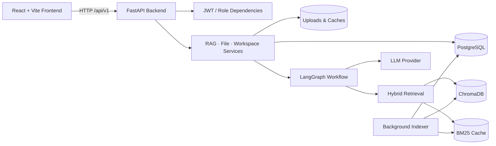
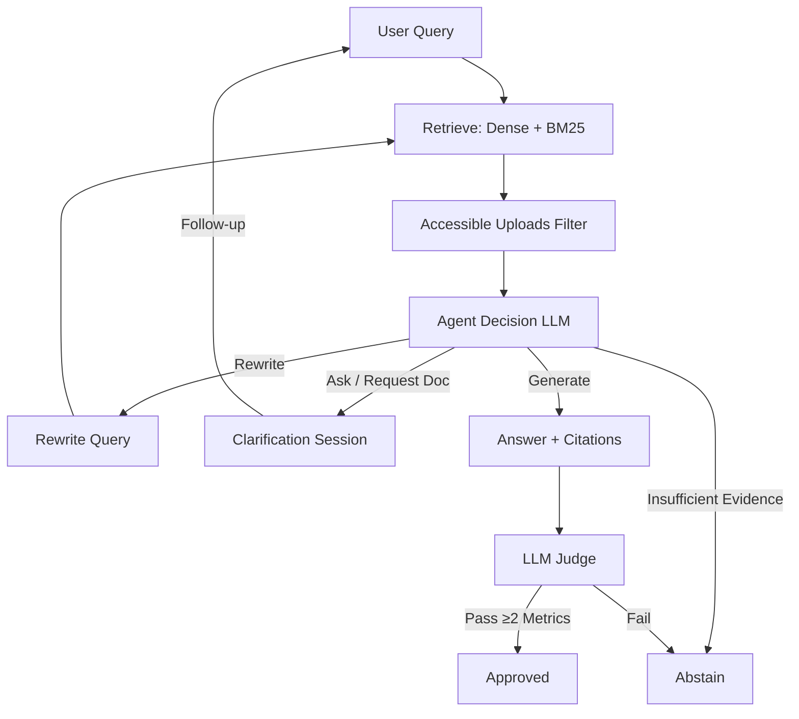

# Dana — Enterprise RAG Platform

> **An enterprise RAG platform for source-grounded search and answering, with access control, automated answer-quality evaluation, and an architecture designed to extend toward knowledge graphs and enterprise data sources.**

---

## 🎤 Elevator Pitch

**Dana** helps organizations get **precise, well-sourced, and trustworthy** answers from their institutional knowledge—instead of digging through scattered files, wikis, and disconnected systems. The key differences:

- **Every answer cites its source** (Source-Grounded)
- **If the evidence isn't sufficient, it abstains** (Abstain instead of Hallucinate)
- **Each user's access to knowledge is controlled** (Permission-Aware Retrieval)
- **Answer quality is automatically judged** (LLM Judge)

The result? Less time spent hunting for knowledge, fewer unsupported AI answers, and a technical foundation ready to connect to Jira, Mizito, enterprise databases, and a Knowledge Graph.

---

## 💼 Business Value (Why It Matters)

| Organizational Challenge | Dana's Solution | Measurable Outcome |
|---|---|---|
| Knowledge scattered across files and systems | Unified ingestion + Hybrid Retrieval | Search time reduced from hours to seconds |
| AI answers with no source and low trust | Citation Validation + LLM Judge + Abstain | Reduced risk of misinformation |
| Information leakage between users/departments | JWT + Public/Private Filter + Workspace ACL | Access control enforced at the retrieval layer |
| No visibility into answer quality | Faithfulness / Citation / Relevance Scoring | Continuous monitoring and improvement |
| Need to connect to new sources | Modular architecture (API / Service / Repository / Ingestion) | Fast development of enterprise connectors |

---

## 🏗️ High-Level Architecture

### Answer Flow (Agentic RAG)

---

## ✨ Key Capabilities

### 🔍 Hybrid Retrieval
- **Dense Retrieval** using `BAAI/bge-m3` on ChromaDB
- **BM25 Lexical Retrieval** for precise keyword coverage
- **Weighted Reciprocal Rank Fusion (RRF)** with configurable weights
- **Relevance Thresholding** and intelligent selection between Hybrid and BM25-only modes

### 🤖 LangGraph-Based Agent
- A bounded, inspectable graph (not an uncontrolled agent)
- Decides between: **Generate / Rewrite / Ask User / Request Document / Abstain**
- Bounded retries for query rewriting
- Ambiguity-handling sessions with TTL

### 🛡️ Sourced and Trustworthy Answers
- Grounded prompt + `[doc_N]` markers
- Citation validation against retrieved documents
- **LLM Judge** across three metrics: Faithfulness, Citation Accuracy, Relevance
- **Abstain** if at least two metrics do not pass their thresholds

### 🔐 Security and Access Control
- JWT (HS256) + bcrypt
- Invite-code-based registration with enforced role
- Chat ownership checks
- Metadata filter on `access_level=public OR user_id=current_user`
- Workspace: Department / Folder / Admin Assignment

### 📥 Ingestion and Knowledge Management
- Supports `.docx`, `.txt`, `.md`
- Chunking based on the `bge-m3` tokenizer (default 400/40)
- Asynchronous indexing with BackgroundTasks
- Knowledge Dashboard for managers
- Upload / Replace / Delete + Index Status + Soft Delete

---

## 🧱 Tech Stack

| Layer | Technology |
|---|---|
| Backend | Python, FastAPI, Pydantic |
| Frontend | React 19, React Router, Vite |
| Database | PostgreSQL (`psycopg2`) |
| Vector Store | ChromaDB (Persistent) |
| Lexical Search | BM25 |
| Embeddings | Sentence Transformers — `BAAI/bge-m3` |
| Orchestration | LangGraph |
| LLM Access | OpenAI-compatible client |
| Evaluation | DeepEval + Retrieval Hit/MRR Tooling |

---

## 📊 Technical Maturity (Honest Scorecard)

| Area | Status | Notes |
|---|---|---|
| Authentication & Roles | ✅ Implemented | JWT, Invite Code, Manager Checks |
| Chat & History | ✅ Implemented | Persistence + Follow-up Sessions |
| File Ingestion | ✅ Implemented (limited) | DOCX/TXT/MD — `.doc` is stored only |
| Hybrid Retrieval | ✅ Implemented | Dense + BM25 + RRF |
| Source-Grounded Answers | 🟡 Partial | Citation validation exists; claim-level entailment does not |
| LLM Judge | ✅ Implemented | Three metrics + threshold |
| Knowledge Admin | ✅ Implemented (Basic) | Public CRUD |
| Versioning | 🟡 Partial | Replace without History |
| Workspace ACL in Retrieval | 🟡 Partial | Department/Folder not applied in retrieval filter |
| Knowledge Graph | ❌ Not Found | Architectural foundation is ready |
| Enterprise Connectors (Jira/Mizito/REST) | ❌ Not Found | Requires a Connector Framework |
| Automated Tests / Release Gate | 🟡 Partial | Evaluation assets exist; no formal Test Suite |
| Durable Job Queue | ❌ Not Found | In-process BackgroundTasks |

> This table reflects the project's philosophy: **transparency about what is built, what is partially built, and what is not yet there.**

---

## 🗺️ Roadmap

### Short Term (Foundation Hardening)
- [ ] Enforce authentication on `/query` and unify access filters in Retrieval
- [ ] Move indexing to a durable queue with retries and idempotency
- [ ] Complete, versioned database schema migrations
- [ ] Make configuration fail-safe (JWT Secret, Provider Keys)
- [ ] Unified test suite + regression gate on evaluation datasets

### Mid Term (Enterprise Readiness)
- [ ] Connector Framework for Jira, Mizito, SQL, and REST
- [ ] Incremental sync + deletion semantics + permission mapping
- [ ] Full document versioning and lifecycle (Review / Approval / Retention)
- [ ] Audit log for accesses and changes
- [ ] Claim-level citation verification

### Long Term (Knowledge Intelligence)
- [ ] Knowledge Graph extraction + entity resolution
- [ ] Graph + Vector fusion retrieval
- [ ] Permission-aware graph traversal
- [ ] Automated classification and enrichment pipeline

---

## 🎯 Why This Project Matters

Dana is not just a RAG demo. It demonstrates how to build an **enterprise knowledge system** that is:

1. **Trustworthy** — because it cites sources and stays silent when evidence is lacking.
2. **Controllable** — because access is enforced at the retrieval layer, not just in the UI.
3. **Measurable** — because the Judge and evaluation datasets are part of the architecture.
4. **Extensible** — because the boundaries between API / Service / Repository / Ingestion are well defined.

---

## 📌 One-Line Summary

> **Dana = Hybrid RAG + Agentic Workflow + Source-Grounded Answers + Permission-Aware Retrieval — with a clear roadmap toward Knowledge Graph and Enterprise Integrations.**

---

## 📎 Additional Documentation

- Full architecture and status report: `docs/technical-architecture-audit.md`
- Evaluation and datasets: `pipelines/eval/`, `data/eval/`
- API Versioning: `/api/v1`

---

**Built with FastAPI · React · LangGraph · ChromaDB · BM25 · BAAI/bge-m3**

